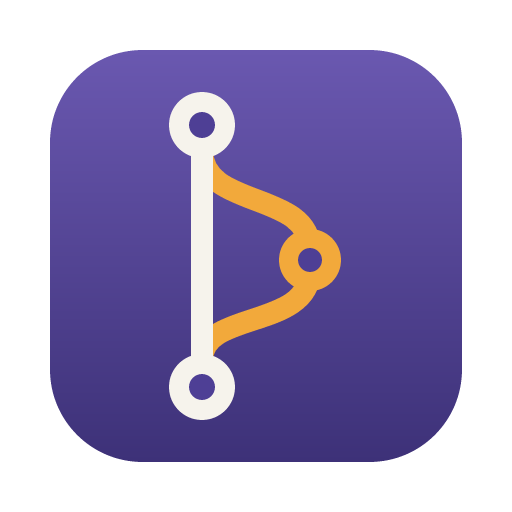

# rama



Explore git repositories: every branch and merge as a coloured commit graph, the full history at
a glance, and each commit's changes down to the line. *Rama* is Spanish for *branch*.

Native desktop app in Rust: [gitoxide](https://github.com/GitoxideLabs/gitoxide) reads the
repository (no libgit2, no `git` binary needed) and [GPUI](https://www.gpui.rs/) with
[gpui-component](https://github.com/longbridge/gpui-component) draws it. macOS, Windows and
Linux. UI in Spanish, English, Portuguese and French.

## Features

- Commit graph with coloured lanes, curved branch and merge lines, author avatars on each commit,
  branch / remote / tag labels, and the checked-out branch highlighted.
- Fast on big repositories: 60 000 commits and 20 000 refs load in under a second; lists are
  virtualised.
- Sidebar with local branches, remote branches and tags; click one to jump to its commit.
- Commit details: full message, author, date, parents (clickable), refs, and changed files with
  added / removed line counts and rename detection.
- Search (⌘F) across commit messages, authors, emails, branch and tag names and SHA prefixes,
  ignoring case and accents; non-matching commits fade, Enter / Shift+Enter jump between matches.
- Unified diff per file with line numbers.
- Keyboard: ↑/↓ or j/k to move, ⌘F to search, Esc to close a diff or clear the search, ⌘C copies the commit SHA, ⌘O opens a repo,
  ⌘R reloads.
- Read-only: rama never writes to your repository.

## Download

Ready-made builds for macOS (Apple silicon and Intel), Linux and Windows are attached to each
[GitHub Release](https://github.com/otherwisetech/rama-rs/releases).

- **macOS:** unzip and drag `rama.app` to Applications. The app is not notarized yet, so the
  first time right-click it → *Open* (or run `xattr -dr com.apple.quarantine /Applications/rama.app`).
- **Linux:** extract the `.tar.gz` and run `./rama`; copy `rama.desktop` and the icon to
  `~/.local/share/applications` / `~/.local/share/icons` for a menu entry. Needs Vulkan.
- **Windows:** unzip and run `rama.exe` (SmartScreen may ask to confirm, since it is unsigned).

The downloads are built by GitHub Actions from the tagged source, but they are **not code-signed
or notarized**. rama makes no network requests.

## Build and run

```sh
cargo run -p rama-app -- path/to/repo        # or no argument for the start screen
cargo run --release -p rama-repo --example log -- path/to/repo   # load history and time it
script/bundle-macos.sh                       # macOS: target/release/rama.app with the icon
```

## Layout

```
crates/graph  rama-graph: topological order and lane layout — no git, no UI
crates/repo   rama-repo: history, refs, changed files and diffs through gitoxide — no UI
crates/i18n   rama-i18n: embedded catalogs (es, en, pt, fr) and i18n guard tests
crates/app    `rama` desktop app
```

## License

MIT or Apache-2.0, at your option.

Developed by [Otherwise Technologies LLC](https://otherwisetech.com), Wyoming, USA.
